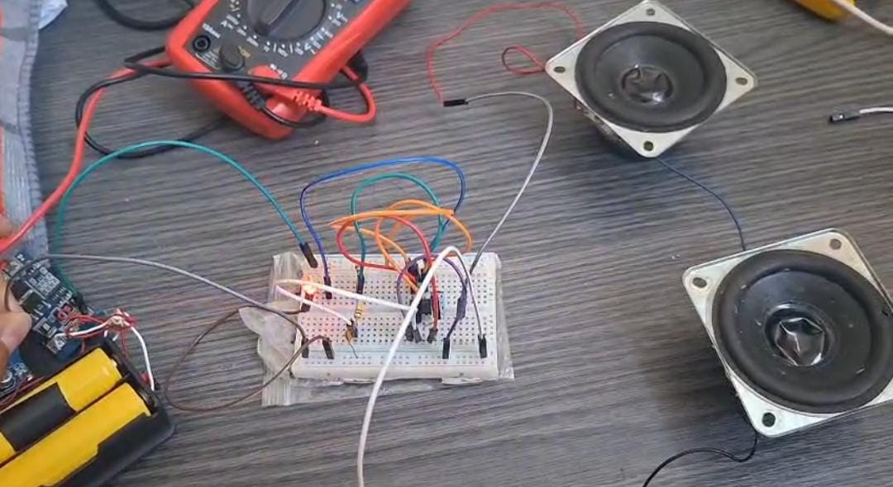
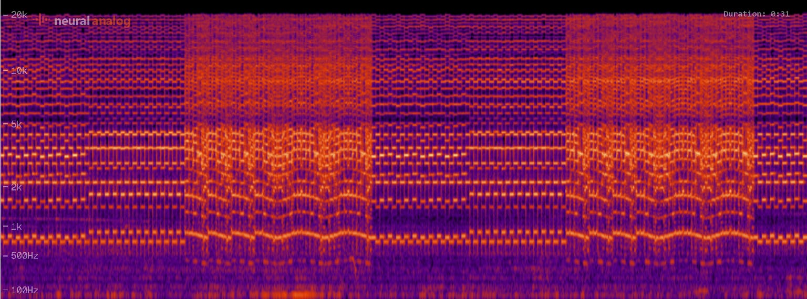

# Caja Musical con NE555

**Universidad Nacional Mayor de San Marcos (UNMSM)**  
**Facultad de Ingeniería Eléctrica y Electrónica**  
**Curso:** Métodos Numéricos  
**Docente:** Josue Miranda

## 1. Descripción del proyecto

El presente proyecto consiste en la implementación de una caja musical utilizando el circuito integrado NE555 en configuración astable, capaz de generar señales eléctricas periódicas cuya frecuencia depende de los valores de resistencia y capacitancia utilizados.

El proyecto integra conceptos de electrónica y métodos numéricos mediante el análisis de frecuencias teóricas y experimentales, empleando técnicas de interpolación y búsqueda de raíces.

## 2. Objetivos

**Objetivo general**

Diseñar e implementar una caja musical basada en el temporizador NE555, aplicando métodos numéricos para analizar la variación de su frecuencia.

**Objetivos específicos**

- Implementar un circuito electrónico con NE555.
- Obtener mediciones experimentales de frecuencia.
- Calcular frecuencias teóricas.
- Aplicar interpolación de Lagrange y splines cúbicos.
- Utilizar el método de bisección para estimar resistencias asociadas a una frecuencia objetivo.
- Comparar resultados teóricos, experimentales y numéricos.

## 3. Fundamento teórico

El temporizador NE555, configurado en modo astable, genera una señal periódica mediante la carga y descarga de un condensador.

La frecuencia teórica aproximada se calcula mediante:

f = 1.44 / ((R1 + 2R2) × C)

Donde:

- f: frecuencia en Hz.
- R1 y R2: resistencias en ohmios.
- C: capacitancia en faradios.

## 4. Métodos numéricos

**Interpolación de Lagrange:** permite estimar frecuencias para valores de resistencia intermedios a partir de mediciones conocidas.

**Splines cúbicos:** permiten construir una curva suave por tramos que represente la relación entre resistencia y frecuencia.

**Método de bisección:** permite aproximar una resistencia asociada a una frecuencia objetivo, utilizando una función interpolada y un intervalo adecuado.

## 5. Prototipo web

Se ha desarrollado un prototipo web que permite importar datos desde Excel y visualizar resultados mediante tres métodos numéricos:

- Interpolación de Lagrange.
- Splines cúbicos naturales.
- Método de bisección.

La página incluye representaciones gráficas, ecuaciones y tablas de resultados.

**Estado:** pendiente de integrar los archivos del prototipo web al repositorio y verificar su funcionamiento con los datos experimentales definitivos.

## 6. Estructura del repositorio

- `web/`: archivos de la página web.
- `datos/`: mediciones experimentales y archivos Excel.
- `imagenes/`: fotografías del circuito.
- `documentacion/`: informes y avances del proyecto.

## 7. Integrantes

- Diego Ramiro Estrada Olano.
- Jordy Slayter Juarez Poccori.
- María Fernanda Curi Cule.
- Jorge Luis Ascue Rivas.

## 8. Estado del proyecto

- [x] Primer avance y descripción del proyecto.
- [x] Construcción del prototipo físico.
- [x] Creación del repositorio GitHub.
- [x] Desarrollo preliminar de la página web.
- [ ] Incorporación del código web al repositorio.
- [ ] Incorporación y verificación de mediciones experimentales.
- [ ] Validación de los resultados numéricos.
- [ ] Integración final de la documentación.

## Evidencias del prototipo experimental

### Montaje del circuito NE555

El prototipo de la caja musical fue implementado
en una protoboard, integrando el circuito electrónico,
la alimentación y los altavoces.

### Análisis de frecuencias

Se realizó un análisis del sonido generado por
la caja musical mediante un espectrograma,
obteniendo mediciones de tiempo y frecuencia.

### Video del funcionamiento del prototipo

Se presenta una demostración experimental del funcionamiento de la caja musical implementada con el circuito NE555.

[Ver video del prototipo](imagenes/funcionamiento_ne555.mp4)

## Aplicación web de métodos numéricos

Se desarrolló una aplicación web interactiva para analizar las mediciones experimentales de tiempo y frecuencia obtenidas de la caja musical con NE555.

La aplicación permite cargar archivos Excel y utilizar tres métodos numéricos:

- **Interpolación de Lagrange:** estimación de frecuencias en tiempos intermedios.
- **Splines cúbicos:** representación continua de la frecuencia en función del tiempo.
- **Método de bisección:** búsqueda del instante aproximado en el que se alcanza una frecuencia objetivo.

### Acceso a la aplicación

[**Abrir página web del proyecto**](https://diegodec.github.io/caja-musical-ne555/web/)

## Documentación del proyecto

- [Primer avance](documentacion/Primer_Avance_Caja_Musical.docx)
- [Informe de frecuencias y métodos numéricos](documentacion/Proyecto_Frecuencia_Metodos_Numericos%20f.docx)

## Evidencias experimentales

- [Fotografía del prototipo](imagenes/prototipo_ne555.jpeg)
- [Espectrograma de frecuencias](imagenes/espectrograma.jpeg)
- [Video del funcionamiento](imagenes/funcionamiento_ne555.mp4)

## Estado del proyecto

El prototipo físico y la aplicación web han sido implementados. Se realizaron pruebas de funcionamiento de los tres métodos numéricos con las mediciones experimentales. La verificación matemática completa de los resultados queda sujeta a revisión.
